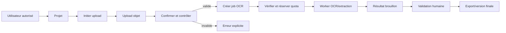

# 01 — Spécifications fonctionnelles et règles métier

## 1. Acteurs proposés

| Portée | Rôle | Responsabilité |
|---|---|---|
| Plateforme | Platform Owner / Super Admin | Exploitation globale, plans, sécurité, audit |
| Plateforme | Support | Diagnostic encadré, sans accès implicite au contenu |
| Organisation | Owner | Gouvernance, abonnement, membres, suppression |
| Organisation | Admin | Administration déléguée hors propriété/facturation sensible |
| Organisation | Manager | Projets, validation et exécution |
| Organisation | Editor | Création et modification de contenus autorisés |
| Organisation | Viewer | Consultation/export explicitement autorisé |
| Organisation | Billing Manager | Abonnement, factures et usage financier |
| Organisation | Custom | Ensemble explicite de permissions |

Le besoin d'un rôle « administrateur de workspace » reste à confirmer : le produit actuel ne modélise pas réellement les workspaces sous une organisation.

## 2. Matrice de permissions cible

Légende : A = administrer, W = écrire/exécuter, R = lire, — = interdit. Les rôles personnalisés remplacent cette matrice par une liste explicite.

| Ressource | Owner | Admin | Manager | Editor | Viewer | Billing |
|---|---:|---:|---:|---:|---:|---:|
| Organisation | A | W | R | — | — | R |
| Membres/rôles | A | W | R | — | — | — |
| Projets | A | A | W | R | R | — |
| Documents/fichiers | A | A | W | W | R | — |
| Validations OCR | A | A | W | W selon délégation | R | — |
| Audio/vidéo | A | A | W | W | R | — |
| Générations | A | A | W | W | R | — |
| Workflows | A | A | W/exécuter | R/exécuter selon délégation | R | — |
| Usage | R | R | R | R | — | R |
| Abonnement/factures | A | R | — | — | — | A |
| Audit organisation | R | R | — | — | — | — |

Toute autorisation doit être vérifiée côté backend sur l'identité, l'appartenance au tenant et la ressource ciblée. Le masquage UI n'est qu'une aide d'expérience utilisateur.

## 3. Spécifications par domaine

| Domaine | Objectif/parcours nominal | Données principales | Erreurs et critères d'acceptation |
|---|---|---|---|
| Identité | Inscription, vérification, connexion, renouvellement, déconnexion, récupération | User, Session, VerificationToken | Identifiants invalides non révélateurs; session révocable; mot de passe haché |
| Organisations | Créer/configurer une organisation et choisir le contexte actif | Organization, Membership | Slug unique; tenant dérivé de la session; suspension opposable |
| Membres/RBAC | Inviter, accepter, attribuer un rôle, révoquer | Invitation, Membership, Role, Permission | Invitation expirée/inutilisable deux fois; dernier Owner protégé |
| Projets | Regrouper les assets et traitements | Project | Accès tenant; suppression explicite; comportement des assets à décider |
| Fichiers | Initier upload, téléverser, confirmer, scanner | FileAsset, UploadSession | Type réel, taille, checksum, statut antivirus, ownership |
| Documents/OCR | Créer document, lancer job, extraire, corriger, valider, exporter | Document, Extraction, FieldRevision, Job | Job idempotent; progression; erreur/reprise; version de validation |
| Audio | Upload, transcription, diarisation, correction, génération de CR | AudioAsset, Transcript, Segment, Speaker | Durée/quota; formats; échec fournisseur; corrections tracées |
| Vidéo | Upload, transcodage/analyse, chapitres/sous-titres | VideoAsset, Chapter, Subtitle, Job | Codec/taille; progression; sortie partielle clairement marquée |
| Générations | Créer un livrable depuis des sources, éditer, versionner, exporter | GeneratedAsset, SourceLink, Version | Provenance; validation; format réellement produit |
| Workflows | Concevoir, publier, exécuter et observer un graphe | Workflow, Version, Node, Execution | Graphe valide; version immuable exécutée; reprise contrôlée |
| Quotas | Autoriser puis comptabiliser une consommation atomique | UsageRecord, Entitlement, Override | Limite 0 respectée; dérogation expirée ignorée; double débit empêché |
| Billing | Souscrire, changer de plan, facturer, réconcilier webhook | Plan, Subscription, Invoice, PaymentEvent | Webhook signé/idempotent; statut abonnement opposable |
| Notifications | Informer sans dupliquer ni exposer de données | Notification, DeliveryAttempt | Préférences; retries bornés; contenu minimal |
| Administration | Superviser sans contourner silencieusement les droits | FeatureFlag, SupportCase, AuditLog | Actions sensibles auditées; impersonation à décider |

## 4. Règles métier transversales

- **BR-TEN-01** : toute ressource métier appartient à une organisation; l'organisation effective vient du contexte authentifié, jamais d'un identifiant client non vérifié.
- **BR-AUTH-01** : refus par défaut; une permission explicite et l'appartenance à la ressource sont toutes deux nécessaires.
- **BR-OWN-01** : une organisation active conserve au moins un Owner.
- **BR-QUO-01** : la vérification et la consommation de quota sont atomiques dans la transaction qui accepte l'opération.
- **BR-QUO-02** : zéro signifie interdit; `null` peut signifier illimité si cette convention est validée.
- **BR-QUO-03** : une dérogation n'est active qu'entre ses bornes et doit être auditée.
- **BR-SUB-01** : une opération payante exige un entitlement actif; la politique de grâce est ouverte.
- **BR-JOB-01** : les traitements lourds répondent `202` avec un job; ils ne bloquent pas la requête.
- **BR-JOB-02** : un job a un état explicite, une progression, une erreur normalisée et une clé d'idempotence.
- **BR-FILE-01** : aucun traitement ne démarre avant confirmation de l'upload, contrôle du type/taille et analyse de sécurité.
- **BR-AI-01** : chaque résultat conserve fournisseur, modèle, version de prompt, sources, coût estimé et statut de validation.
- **BR-AUD-01** : les actions administratives, permissions, exports et suppressions sensibles sont auditables sans journaliser les secrets/contenus complets.
- **BR-DEL-01** : une suppression logique précède la purge; durées et restauration restent à valider.
- **BR-EXP-01** : l'interface annonce uniquement le format réellement généré.

## 5. Parcours critique document

## 6. Questions bloquantes

La hiérarchie Organization/Workspace, le fournisseur de paiement, les fournisseurs OCR/transcription, la résidence des données, les durées de rétention et le modèle exact de crédits ne sont pas définis. Ils sont détaillés dans le registre des décisions.
