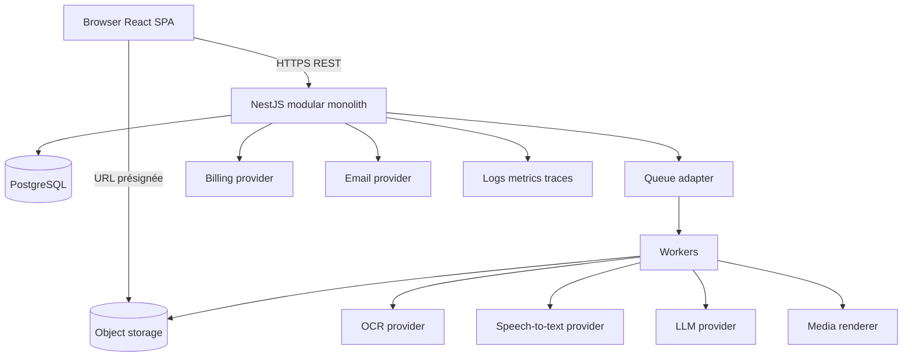
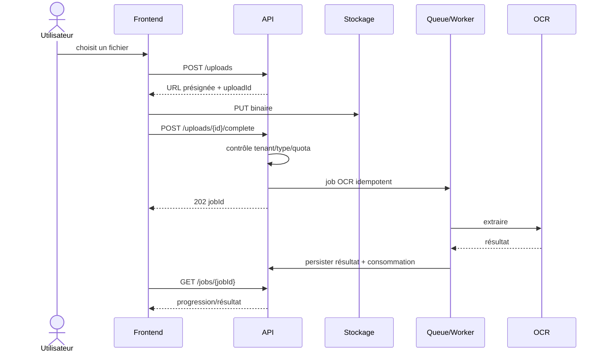

# 02 — Architecture cible

## 1. Principes

- Monolithe modulaire NestJS avant toute hypothèse de microservices.
- PostgreSQL comme source de vérité; stockage objet pour les binaires.
- API REST versionnée `/api/v1`, contrats OpenAPI et validation stricte.
- Traitements lourds asynchrones via une abstraction de queue.
- Frontend migré repository par repository, sans bascule globale risquée.
- Autorisation et quotas opposables côté backend.

## 2. Vue d'ensemble



## 3. Modules backend proposés

| Module | Responsabilité | Dépendances autorisées | Tests clés |
|---|---|---|---|
| Identity | utilisateurs, credentials, sessions, vérification | Notifications, Audit | auth, rotation, révocation, brute force |
| Tenancy | organisations, memberships, rôles | Identity, Audit | isolation, dernier Owner |
| Projects | espaces de classement | Tenancy | ownership, suppression |
| Files | upload, métadonnées, stockage, scan | Tenancy, Projects, Jobs | MIME, taille, checksum, ACL |
| Documents | document, OCR, champs, validation | Files, Jobs, Usage | state machine, révisions |
| Media | audio/vidéo, transcripts, chapitres | Files, Jobs, Usage | durées, corrections |
| Generations | documents, présentations, exports | Documents/Media, Jobs, Usage | provenance, versions |
| Workflows | définition, version, exécution | Jobs, Usage, Audit | validation graphe, idempotence |
| Jobs | cycle de vie asynchrone | Queue adapter | retries, lease, annulation |
| Usage | entitlements, quotas, ledger | Tenancy, Billing | concurrence, période, overrides |
| Billing | plans, subscriptions, invoices, webhooks | Usage, Audit | signatures, idempotence |
| Notifications | préférences et livraisons | provider adapter | retries, opt-out |
| Administration | support, flags, supervision | modules en lecture/commandes contrôlées | permission globale, audit |
| Audit | événements append-only | aucun domaine métier direct | intégrité, redaction |

Les modules exposent des services applicatifs; l'accès Prisma reste derrière leurs repositories. Aucun contrôleur ne doit appeler Prisma directement.

## 4. Architecture frontend cible

```text
src/
  app/                 providers, router, error boundaries
  features/<domain>/   api, components, hooks, pages, schemas, types
  shared/              composants UI, HTTP client, auth, erreurs
  mocks/               adaptateurs de démonstration isolés
```

- Routes chargées paresseusement par domaine.
- Client HTTP central : corrélation, refresh contrôlé, erreurs normalisées.
- Cache serveur via une bibliothèque à choisir; état UI local avec React.
- Formulaires validés par schémas partagés/générés depuis OpenAPI lorsque pertinent.
- `PermissionGate` pour l'UX, sans remplacer les contrôles serveur.
- Upload direct vers stockage objet avec progression et reprise éventuelle.

### Migration progressive des mocks

1. Définir les contrats API et tests de contrat.
2. Conserver les interfaces de repository utiles, séparées par domaine.
3. Ajouter une implémentation HTTP pour un seul vertical.
4. Sélectionner explicitement Mock/API au bootstrap.
5. Migrer document → auth/tenant → fichiers/OCR avant les autres studios.
6. Supprimer chaque mock seulement après parité fonctionnelle et E2E.

## 5. Architecture asynchrone

### Besoins

Durabilité, retries avec backoff, dead-letter, idempotence, progression, annulation limitée, concurrence par organisation et métriques de latence/coût.

### Options

| Option | Avantages | Inconvénients | Usage recommandé |
|---|---|---|---|
| PostgreSQL + worker/polling | Peu d'infrastructure, transaction facile | Débit limité, polling | MVP et charge modérée |
| Redis + BullMQ | Écosystème Node mature, délais/retries | Service Redis supplémentaire | Si progression et volume justifient Redis |
| Broker managé | Haute durabilité/élasticité | Coût, lock-in, complexité | Après mesure de charge |

Recommandation initiale : abstraction `JobQueue` et implémentation PostgreSQL simple pour le premier vertical, avec critères mesurés déclenchant BullMQ ou un service managé.

### États

`queued → running → succeeded | failed | cancelled`, avec `retrying` dérivé du nombre de tentatives. Les résultats partiels doivent avoir un statut explicite, pas être présentés comme terminés.

## 6. Intégrations IA

- Ports distincts : `OcrProvider`, `SpeechToTextProvider`, `LlmProvider`, `PresentationRenderer`, `VideoRenderer`.
- Registre de modèles/capacités, sans fournisseur codé dans le métier.
- Prompts versionnés et testés; sortie structurée validée par schéma.
- Timeout, classification des erreurs, retry uniquement sur erreurs transitoires.
- Budget/coût enregistré par tâche et organisation.
- Redaction des secrets/PII dans les logs.
- Consentement et localisation des données alignés sur les fournisseurs choisis.

## 7. Séquence OCR cible



