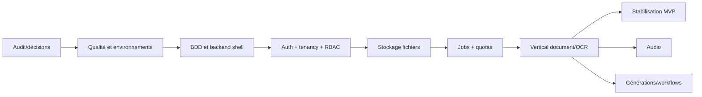

# 08 — Feuille de route et backlog

## 1. Chemin critique

Le premier produit réel recommandé est le vertical document/OCR. Audio, vidéo et studios ne doivent pas progresser simultanément avant que les fondations soient prouvées.

## 2. Lots d'implémentation

| Lot | Objectif | Dépendances | Travaux majeurs | Tests/validation | Complexité |
|---|---|---|---|---|---|
| L0 | Valider décisions et périmètre MVP | aucune | choix ouverts, ADR, critères | revue documentaire | S |
| L1 | Rendre le frontend vérifiable | L0 | corriger typecheck, strict progressif, lint/format/test/CI | typecheck/build/smoke | M |
| L2 | Socle backend + PostgreSQL | L0 | NestJS, config, Prisma, health, erreurs, OpenAPI | unit/intégration/build | M |
| L3 | Identité et sessions | L2 | register/login/verify/reset/session/rate limit | API/sécurité/E2E | L |
| L4 | Organisations et RBAC | L3 | org, memberships, invitations, roles/policies | matrice BOLA | L |
| L5 | Fichiers et stockage | L4 | upload présigné, scan, metadata, ACL | upload/security/E2E | L |
| L6 | Jobs et usage | L4,L5 | state machine, worker, idempotence, quota ledger | concurrence/retry | L |
| L7 | Documents et OCR | L5,L6 | document, provider OCR, extraction, validation, export | vertical E2E | XL |
| L8 | Migration frontend API document | L7 | client HTTP, repositories API, états UX | component/contract/E2E | L |
| L9 | Billing/entitlements | L4,L6 | plans, subscription, webhook, invoices | webhook/idempotence | L |
| L10 | Audio | L6,L8 | upload, STT, diarisation, corrections | provider/vertical E2E | XL |
| L11 | Vidéo | L6,L8 | transcodage, analyse, chapitres | charge/vertical E2E | XL |
| L12 | Générations | L7,L10 | provenance, versions, renderers | qualité/export | XL |
| L13 | Workflows | L6 + domaines appelés | version, validation, orchestration | graphe/reprise/E2E | XL |
| L14 | Admin/audit/notifications | L4,L9 | supervision, support, audit, notifications | privilege/audit | L |
| L15 | Production readiness | tous MVP | observabilité, backups, perf, security, runbooks | restore/load/pentest | XL |

## 3. Backlog initial hiérarchisé

Tous les éléments ont le statut initial **À faire**.

### EPIC E1 — Fondations fiables (P0)

- **F1.1 Qualité frontend**
  - **US-001** — En tant que développeur, je souhaite un typecheck strict et reproductible afin de détecter les contrats invalides.
    - Critères : erreur actuelle corrigée par le vrai modèle; aucun `any` nouveau; CI bloque les erreurs.
    - Tâches : inventaire `any`; activer règles par étapes; séparer `lint`/`typecheck`; tests de régression.
    - Dépendance : L0. Complexité M. Docs : procédures de test.
- **F1.2 Socle backend**
  - **US-002** — En tant qu'opérateur, je souhaite une API versionnée avec health checks afin d'exploiter le service.
    - Critères : config validée au démarrage, erreurs normalisées, OpenAPI, health readiness.
    - Tests : unit config, intégration PostgreSQL, smoke Docker. Complexité M.

### EPIC E2 — Identité et isolation (P0)

- **US-010** — En tant qu'utilisateur, je souhaite créer et vérifier mon compte afin d'accéder sûrement au produit.
  - Critères : email unique normalisé, Argon2id, token expirant, réponse anti-enumeration.
  - Tests : nominal, doublon, token expiré/rejoué, rate limit. Complexité L.
- **US-011** — En tant qu'Owner, je souhaite inviter un membre avec un rôle afin de collaborer.
  - Critères : invitation tenant-scopée, expiration, rôle assignable, dernier Owner protégé.
  - Tests : autre tenant, doublon, expiration, permission. Complexité L.
- **US-012** — En tant que responsable sécurité, je souhaite que toute ressource soit isolée par tenant.
  - Critères : repositories exigent TenantContext; matrice BOLA verte. Complexité L.

### EPIC E3 — Vertical Document Intelligence (P0)

- **US-020** — En tant qu'éditeur, je souhaite téléverser un document contrôlé afin de le traiter.
  - Critères : présignature, taille/MIME/checksum, scan, progression, erreurs visibles. Complexité L.
- **US-021** — En tant qu'éditeur, je souhaite lancer un OCR asynchrone afin d'obtenir des champs structurés.
  - Critères : `202`, job observable, quota atomique, idempotence, fournisseur défaillant géré. Complexité XL.
- **US-022** — En tant que validateur, je souhaite corriger et valider les champs afin de produire une version traçable.
  - Critères : révision, auteur/date, concurrence optimiste, export réel. Complexité L.

### EPIC E4 — Monétisation et exploitation (P1)

- **US-030** — En tant qu'Owner, je souhaite voir consommation et limites afin d'anticiper un blocage.
- **US-031** — En tant que Billing Manager, je souhaite changer de plan afin d'activer des entitlements.
- **US-032** — En tant qu'admin, je souhaite auditer une dérogation afin de contrôler les abus.

Pour chacune : critères quota atomique, webhook signé/idempotent, audit append-only; tests unitaires, intégration et E2E; complexité L.

### EPIC E5 — Médias et automatisation (P2)

- **US-040** transcription/diarisation audio.
- **US-041** analyse/chapitrage vidéo.
- **US-042** génération versionnée de livrables.
- **US-043** publication/exécution de workflows immuables.

Chaque story doit être raffinée après mesure du vertical OCR et choix des fournisseurs. Complexité XL; dépend de E1–E4.

## 4. Conditions de validation des lots

Contrats/ADR approuvés, critères verts, tests réellement exécutés, revue indépendante, sécurité tenant vérifiée, documentation mise à jour, guide manuel exécuté et aucun risque critique non accepté.

