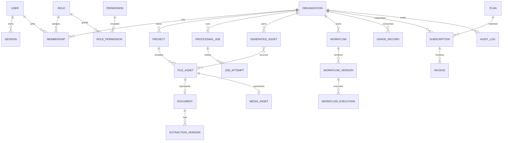

# 03 — Conception des données PostgreSQL/Prisma

Ce document décrit la cible relationnelle. Le dépôt contient désormais une ébauche Prisma (`User`, `Organization`, `Membership`, `Session`), mais son alignement, sa génération de migration et son application à PostgreSQL restent à vérifier. Cette ébauche n'est pas encore le modèle métier complet.

## 1. Conventions

- Identifiants UUID générés serveur.
- Dates UTC `timestamptz`; montants en unité mineure + devise ISO.
- `organizationId` obligatoire sur toute ressource tenant-scopée et inclus dans les index d'accès.
- Contraintes uniques composites pour empêcher les collisions inter/intra-tenant.
- Suppression logique uniquement là où restauration/rétention l'exige; purge asynchrone auditée.
- JSON réservé aux configurations variables, jamais aux relations centrales.

## 1.1. Modèle du premier vertical (à livrer par étapes)

Le premier périmètre est l'upload et le traitement OCR d'un document au sein d'une organisation. Les tables MVP sont :

| Groupe | Modèles | Règles structurantes |
|---|---|---|
| Identité et tenant | `User`, `Session`, `Organization`, `Membership`, `Invitation` | e-mail normalisé unique; token Bearer aléatoire dont seul le hash est persisté; membership unique par organisation/utilisateur; invitation à usage unique, expirante et liée au tenant |
| Gouvernance | `Role`, `Permission`, `RolePermission` (ou rôle système enum au premier incrément) | Refus par défaut; permissions évaluées côté serveur; empêcher la suppression/rétrogradation du dernier Owner |
| Classement | `Project` | Chaque projet porte `organizationId`; accès et unicité sont tenant-scopés |
| Ingestion | `FileAsset` | tenant et projet, nom d'origine, clé privée de stockage, MIME détecté, octets, checksum, état upload/scan; jamais le binaire en JSON/DB |
| OCR | `Document`, `ExtractionVersion`, `ExtractionFieldRevision` | document référence un fichier du même tenant; chaque relance crée un job/version; corrections humaines conservent auteur, date et valeur précédente |
| Asynchronisme | `ProcessingJob`, `JobAttempt` | type/état/progression, clé d'idempotence tenant-scopée, compteurs/retries, erreur normalisée, dates de prise en charge/fin |
| Quotas | `Plan`, `Entitlement`, `Subscription`, `UsageRecord`, `QuotaOverride` | consommation append-only et dédupliquée par source; vérification et réservation atomiques avec création du job; valeur 0 interdit; override motivé et borné |
| Traçabilité | `AuditLog` | événements append-only, métadonnées minimisées, aucune donnée de fichier, token ou secret |

Relations clés : `Organization → Membership/Project/FileAsset/ProcessingJob/UsageRecord`; `Project → FileAsset`; `FileAsset → Document`; `Document → ExtractionVersion → FieldRevision`; `ProcessingJob → JobAttempt`; `User → Session/Membership/Invitation/AuditLog`. Chaque FK multi-tenant doit empêcher autant que possible de relier un enfant à un parent d'une autre organisation, via clés composites (ex. `(organizationId, projectId)`) ou vérification repository systématique. Les requêtes de ressource doivent toujours filtrer par tenant et identifiant.

À remettre à une décision produit avant de figer : le frontend porte des `workspaceId` de démonstration, mais la hiérarchie Organization→Workspace n'est pas définie. Le MVP conserve `Organization` comme tenant et `Project` comme classement seulement si cela est validé; ne pas créer une table Workspace ou une permission de workspace par simple déduction des mocks. Les fournisseurs, région, durée de rétention, soft-delete/purge et politique d'abonnement restent également à trancher.

## 2. ERD proposé



## 3. Catalogue des entités

| Entité | Champs essentiels | Contraintes/index | Suppression |
|---|---|---|---|
| User | email normalisé, passwordHash, status, verifiedAt | unique email; index status | anonymisation/purge réglementée |
| Session | userId, tokenHash, expiresAt, revokedAt, device | unique tokenHash; expiresAt | purge après expiration |
| Organization | name, slug, status, locale, timezone | unique slug | soft delete puis purge |
| Membership | orgId, userId, roleId, status | unique(orgId,userId); index userId | hard delete auditée |
| Invitation | orgId, emailNormalized, roleId, tokenHash, expiresAt, acceptedAt, revokedAt | tokenHash unique; index(orgId,emailNormalized,expiresAt) | invalidation et purge selon rétention |
| Role | orgId nullable, key, name, system | unique(orgId,key) | restreinte si assigné |
| Permission | key, description | unique key | seed versionné |
| Project | orgId, title, status, ownerId | index(orgId,status,updatedAt) | politique assets à décider |
| FileAsset | orgId, projectId, storageKey, name, MIME, bytes, checksum, scanStatus | unique storageKey; index(orgId,projectId) | objet + ligne via purge |
| Document | orgId, fileId, kind, status, currentExtractionId | unique fileId; index(orgId,status) | suit fichier |
| ExtractionVersion | documentId, schemaVersion, dataJson, confidence, validatedBy | unique(documentId,version) | conserver selon rétention |
| MediaAsset | orgId, fileId, kind, durationMs, status | unique fileId | suit fichier |
| TranscriptSegment | mediaId, speakerId, startMs, endMs, text | index(mediaId,startMs) | cascade contrôlée |
| ProcessingJob | orgId, type, status, progress, idempotencyKey, inputRef, errorCode | unique(orgId,idempotencyKey); index queue | purge après rétention |
| JobAttempt | jobId, attempt, startedAt, endedAt, error | unique(jobId,attempt) | cascade |
| GeneratedAsset | orgId, type, status, title, currentVersion | index(orgId,type,updatedAt) | soft delete |
| AssetVersion | assetId, version, contentRef/data, promptVersion | unique(assetId,version) | conservation configurable |
| Workflow | orgId, name, status, publishedVersionId | index(orgId,status) | soft delete |
| WorkflowVersion | workflowId, version, graphJson, publishedAt | unique(workflowId,version) | immuable |
| WorkflowExecution | orgId, versionId, status, idempotencyKey | unique(orgId,idempotencyKey) | rétention jobs |
| UsageRecord | orgId, resourceKey, quantity, periodStart, sourceId | unique(orgId,resourceKey,sourceId) | ledger append-only |
| QuotaOverride | orgId, key, value, startsAt, endsAt, reason | index(orgId,key,endsAt) | conserver pour audit |
| Plan | key, version, status, limitsJson, prices | unique(key,version) | immutable si utilisé |
| Subscription | orgId, planId, providerRef, status, period | une active selon règle | conserver historique |
| Invoice | orgId, subscriptionId, providerRef, amountMinor, currency, status | unique providerRef | légale/audit |
| Notification | orgId, userId, type, payload minimal, readAt | index(userId,readAt) | purge configurable |
| AuditLog | orgId nullable, actorId, action, resource, metadata redacted, occurredAt | index(orgId,occurredAt) | append-only/rétention |

## 4. Isolation et intégrité

- Les services injectent un `TenantContext`; les repositories exigent ce contexte.
- Les recherches par identifiant utilisent `(organizationId, id)`.
- Les relations inter-tenant sont interdites par validation applicative et, lorsque possible, clés composites.
- Les écritures quota/job/ressource utilisent une transaction.
- PostgreSQL Row-Level Security est une défense additionnelle à évaluer, pas un remplacement des contrôles applicatifs.

## 5. Ébauche Prisma illustrative

```prisma
model Project {
  id             String   @id @default(uuid()) @db.Uuid
  organizationId String   @db.Uuid
  title          String   @db.VarChar(200)
  status         String   @db.VarChar(32)
  createdAt      DateTime @default(now()) @db.Timestamptz(3)
  updatedAt      DateTime @updatedAt @db.Timestamptz(3)

  @@index([organizationId, status, updatedAt])
}

model ProcessingJob {
  id             String   @id @default(uuid()) @db.Uuid
  organizationId String   @db.Uuid
  type           String   @db.VarChar(64)
  status         String   @db.VarChar(32)
  progress       Int      @default(0)
  idempotencyKey String   @db.VarChar(128)
  errorCode      String?  @db.VarChar(64)
  createdAt      DateTime @default(now()) @db.Timestamptz(3)

  @@unique([organizationId, idempotencyKey])
  @@index([status, createdAt])
}
```

Les enums, relations et noms définitifs attendent validation des décisions métier.

## 6. Stratégie de migration

Il n'existe pas de données serveur à migrer. Les données `localStorage` sont des fixtures de démonstration et ne doivent pas être importées automatiquement. Créer un seed explicite sans credentials réels. Chaque évolution future suit : schema → revue SQL généré → sauvegarde → migration staging → tests → production. `prisma db push` n'est pas une stratégie de production.

