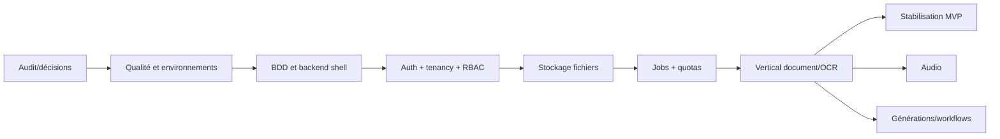

# 08 — Feuille de route et backlog

## 0. État de départ vérifié (6 novembre 2026)

- **L2 est partiellement réalisé** : configuration Nest, Prisma/PostgreSQL, health, erreurs, validation globale, sécurité HTTP de base et OpenAPI sont présents. Il reste à confirmer la connexion DB, générer/vérifier le client et valider les migrations sans effacer de données.
- Le schéma Prisma n'est plus vide : identité, organisation, membership et session sont ébauchés, sans endpoints ni migration métier confirmée.
- Les fonctionnalités métier restent à faire. Le frontend reste sur mocks; `VITE_DATA_MODE=API` n'est pas câblé. Les nouveaux lots L0-L13 ci-dessous remplacent le découpage L0-L15 historique.
- L0 doit être fermé sur les choix bloquants (notamment Workspace, fournisseurs, stockage/région, rétention et politique quotas). Le choix de scope MVP OCR et d'auth Bearer a déjà été exprimé dans la conversation et est retenu comme base de conception.
- La commande frontend `lint` est actuellement un alias de `tsc --noEmit`; l'état de typecheck doit être réexécuté avant le lot L1. Les tests backend existants ne couvrent que la configuration et health.

### Ordre d'implémentation retenu

Chaque lot ci-dessous doit être livré et revu séparément. Le périmètre initial va de L0 à L7; les lots suivants dépendent des résultats et décisions d'intégration. Aucun lot n'autorise l'effacement de la base.

## 1. Chemin critique

Le premier produit réel recommandé est le vertical document/OCR. Audio, vidéo et studios ne doivent pas progresser simultanément avant que les fondations soient prouvées.

## 2. Lots d'implémentation

| Lot | Résultat livrable et périmètre | Zones/fichiers à toucher | Dépendances et critères de sortie |
|---|---|---|---|
| **L0 — Environnement et décisions bloquantes** | Réparer/valider la connexion PostgreSQL de développement; confirmer Node/Bun/Prisma; choisir Organization vs Workspace, stockage/région, fournisseur OCR, rétention et stratégie refresh Bearer. | `backend/.env` (uniquement si correction confirmée), `compose.yaml`, `backend/prisma.config.ts`, ADR et `docs/09-decisions-risks-glossary.md`. | Aucun. Pas de reset ni de migration tant que l'auth DB n'est pas validée. Sortie : readiness DB vérifiée, décisions qui bloquent le MVP documentées, secrets absents des logs. |
| **L1 — Qualité et contrats communs** | Rendre les commandes frontend/backend fiables; corriger les erreurs de type existantes; séparer lint/typecheck; établir tests/CI minimaux; figer format d'erreur, pagination, validation DTO et Bearer. | `frontend/package.json`, configs TypeScript/lint/tests; `backend/package.json`, `backend/src/bootstrap.ts`, OpenAPI; pipeline CI à créer si dépôt le confirme. | L0. Sortie : lint, typecheck, tests et builds reproductibles; contrats communs revus et documentés. |
| **L2 — Fondations Prisma et migration initiale** | Aligner l'ébauche `User`, `Organization`, `Membership`, `Session` sur le modèle approuvé; ajouter contraintes/index et migration non destructive; vérifier génération client. | `backend/prisma/schema.prisma`, `backend/prisma/migrations/`, scripts backend, `docs/03-database-design.md`. | L0, L1. Sortie : SQL migratoire relu, base sauvegardée si données à préserver, migration appliquée explicitement, health ready fonctionne. Aucune suppression de données pour contourner un drift. |
| **L3 — Authentification et sessions** | Inscription, connexion, déconnexion, renouvellement/révocation, récupération et vérification selon la politique email approuvée; sessions Bearer opaques, secret uniquement hashé; limitation brute-force. | `backend/src/identity/` (module, contrôleur, DTO, service, tests), schéma/migration; frontend `AuthContext` et pages login/register/reset seulement après contrat stable. | L2. Sortie : tests mot de passe, token expiré/rejoué, email inconnu anti-enumeration, rate limit et révocation; aucun mot de passe/token en clair stocké ou journalisé. |
| **L4 — Organisations, memberships et autorisations** | Création/sélection d'organisation; invitations à usage unique; rôles et permissions serveur; protection du dernier Owner; tenant issu de l'identité et vérifié sur chaque requête. | `backend/src/tenancy/`, guards/policies partagés, modèles `Organization/Membership/Invitation/Role`; `AuthContext`/sélecteur org ensuite. | L3. Sortie : tests positifs/négatifs par rôle, accès inter-tenant refusé en 404/403 conformément au contrat, invitation expirée/rejouée rejetée. |
| **L5 — Projets, upload et stockage privé** | Projets tenant-scopés; session upload présignée; confirmation, taille/type réel/checksum, état antivirus/quarantaine; téléchargement via URL courte après ACL. | `backend/src/projects/`, `backend/src/files/`, adaptateur stockage choisi; schéma/migration; `DocumentsPage` et abstraction repository à connecter ultérieurement. | L4 et décision stockage L0. Sortie : tests mime mensonger, taille, checksum, projet d'un autre tenant, fichier non scanné; aucun chemin local ou objet public non autorisé. |
| **L6 — Jobs durables et quotas** | Cycle de vie asynchrone, tentatives bornées, idempotence, progression/erreur/cancel contrôlé; ledger d'usage et réservation atomique incluant limite zéro et overrides bornés. Choisir queue PostgreSQL MVP ou autre après mesure. | `backend/src/jobs/`, `backend/src/usage/`, worker/queue adapter; `ProcessingJob`, `JobAttempt`, `UsageRecord`, `QuotaOverride`; `QuotaContext` raccordé plus tard. | L4-L5. Sortie : tests concurrence/doublons/retry/limite zéro/override expiré; aucune requête HTTP longue pour le traitement. |
| **L7 — Vertical Documents/OCR réel** | Créer le document depuis un fichier validé; lancer OCR en `202`; stocker extractions versionnées et corrections humaines; produire l'export réellement annoncé. | `backend/src/documents/`, port/adaptateur OCR, migrations extraction; contrats OpenAPI; tests d'intégration/E2E. | L5-L6 et fournisseur approuvé L0. Sortie : parcours fichier→job→résultat→correction/validation→export réel; erreurs fournisseur, timeout, idempotence et coût gérés. |
| **L8 — Connexion du frontend au vertical OCR** | Ajouter client HTTP central et repositories API pour projets/documents/jobs/OCR; états chargement, vide, erreur, interdit; bascule Mock/API explicite et conserver le mode démo. | `frontend/src/repositories/` (séparer les domaines avant adaptation), client API à créer, `frontend/src/App.tsx`, `DocumentsPage`, `DocumentDetailPage`, `OcrPage`, `HistoryPage`, `QuotaContext`. | L7. Sortie : tests contrat et E2E upload→OCR→validation; aucun résultat mock présenté en mode API; tests manuels responsive du parcours. |
| **L9 — Usage, billing et entitlements** | Plans versionnés, abonnement, factures, événements webhook signés/idempotents; appliquer l'état d'abonnement à l'usage facturable; admin quota override audité. | `backend/src/billing/`, `backend/src/usage/`, `backend/src/admin/`, schéma/migrations; frontend Billing/Admin uniquement via APIs. | L4, L6 et choix prestataire/pays/devise/taxes. Sortie : tests webhook invalide/dupliqué/hors ordre, changement entitlement et autorisation admin. |
| **L10 — Membres, audit, support et administration** | Terminer gestion de membres/rôles, journal append-only et écrans de supervision/backoffice; permissions plateforme séparées des rôles d'organisation; accès support limité et audité. | `backend/src/audit/`, `backend/src/admin/`, `backend/src/notifications/` si nécessaires; pages `frontend/src/pages/admin/*`, `MembersPage`, `RolesPage`. | L3-L4, L9 selon les écrans. Sortie : tests d'escalade privilège, tenant, rétention/redaction; chaque action sensible possède acteur, raison et résultat audités. |
| **L11 — Audio et vidéo** | Upload média, transcription/diarisation puis analyse vidéo/chapitres via jobs, corrections traçables et quotas par durée. | `backend/src/media/` (ou domaines séparés si le besoin le justifie), adaptateurs STT/vidéo; `AudioPage`, `VideoPage`, détails et historique. | L5-L8, choix fournisseur/région/rétention. Sortie : tests formats/durée/échec/reprise/coût; aucun texte ou chapitre mocké en mode API. |
| **L12 — Générations et workflows** | Livrables versionnés avec provenance/source; vrais rendus/export; workflow versionné, validé et exécuté par worker. | `backend/src/generations/`, `backend/src/workflows/`; studios et éditeur workflow frontend. | L6-L8 et domaines sources. Sortie : tests provenance, graphe invalide, version immuable, reprise; formats annoncés ouverts et vérifiés. |
| **L13 — Préparation production** | Observabilité API/worker, sauvegardes/restauration, sécurité, charge, migration/rollback, politique rétention, runbooks et revue conformité. | Infra/CI, déploiement, docs sécurité/DevOps, tous modules MVP. | MVP et décisions restantes. Sortie : restore testé, objectifs RPO/RTO approuvés, scans et tests sécurité effectués, plan de rollback praticable. |

**Gate commun à chaque lot :** critères d'acceptation vérifiables, revue indépendante, migration SQL relue, tests réellement exécutés, docs/OpenAPI synchronisées et guide manuel fourni. Si un prérequis échoue, arrêter le lot concerné sans neutraliser les contrôles ni supprimer la base.

## 3. Backlog initial hiérarchisé

Tous les éléments ont le statut initial **À faire**.

### EPIC E1 — Fondations fiables (P0)

- **F1.1 Qualité frontend**
  - **US-001** — En tant que développeur, je souhaite un typecheck strict et reproductible afin de détecter les contrats invalides.
    - Critères : erreur actuelle corrigée par le vrai modèle; aucun `any` nouveau; CI bloque les erreurs.
    - Tâches : inventaire `any`; activer règles par étapes; séparer `lint`/`typecheck`; tests de régression.
    - Dépendance : L0. Complexité M. Docs : procédures de test.
- **F1.2 Socle backend**
  - **US-002** — En tant qu'opérateur, je souhaite une API versionnée avec health checks afin d'exploiter le service.
    - Critères : config validée au démarrage, erreurs normalisées, OpenAPI, health readiness.
    - Tests : unit config, intégration PostgreSQL, smoke Docker. Complexité M.

### EPIC E2 — Identité et isolation (P0)

- **US-010** — En tant qu'utilisateur, je souhaite créer et vérifier mon compte afin d'accéder sûrement au produit.
  - Critères : email unique normalisé, Argon2id, token expirant, réponse anti-enumeration.
  - Tests : nominal, doublon, token expiré/rejoué, rate limit. Complexité L.
- **US-011** — En tant qu'Owner, je souhaite inviter un membre avec un rôle afin de collaborer.
  - Critères : invitation tenant-scopée, expiration, rôle assignable, dernier Owner protégé.
  - Tests : autre tenant, doublon, expiration, permission. Complexité L.
- **US-012** — En tant que responsable sécurité, je souhaite que toute ressource soit isolée par tenant.
  - Critères : repositories exigent TenantContext; matrice BOLA verte. Complexité L.

### EPIC E3 — Vertical Document Intelligence (P0)

- **US-020** — En tant qu'éditeur, je souhaite téléverser un document contrôlé afin de le traiter.
  - Critères : présignature, taille/MIME/checksum, scan, progression, erreurs visibles. Complexité L.
- **US-021** — En tant qu'éditeur, je souhaite lancer un OCR asynchrone afin d'obtenir des champs structurés.
  - Critères : `202`, job observable, quota atomique, idempotence, fournisseur défaillant géré. Complexité XL.
- **US-022** — En tant que validateur, je souhaite corriger et valider les champs afin de produire une version traçable.
  - Critères : révision, auteur/date, concurrence optimiste, export réel. Complexité L.

### EPIC E4 — Monétisation et exploitation (P1)

- **US-030** — En tant qu'Owner, je souhaite voir consommation et limites afin d'anticiper un blocage.
- **US-031** — En tant que Billing Manager, je souhaite changer de plan afin d'activer des entitlements.
- **US-032** — En tant qu'admin, je souhaite auditer une dérogation afin de contrôler les abus.

Pour chacune : critères quota atomique, webhook signé/idempotent, audit append-only; tests unitaires, intégration et E2E; complexité L.

### EPIC E5 — Médias et automatisation (P2)

- **US-040** transcription/diarisation audio.
- **US-041** analyse/chapitrage vidéo.
- **US-042** génération versionnée de livrables.
- **US-043** publication/exécution de workflows immuables.

Chaque story doit être raffinée après mesure du vertical OCR et choix des fournisseurs. Complexité XL; dépend de E1–E4.

## 4. Conditions de validation des lots

Contrats/ADR approuvés, critères verts, tests réellement exécutés, revue indépendante, sécurité tenant vérifiée, documentation mise à jour, guide manuel exécuté et aucun risque critique non accepté.

